# ImageHunter

Phones make it effortless to record everyday life, but they also turn photos and videos into a vast personal archive. Untitled moments can quietly disappear into it, simply because they are hard to find. ImageHunter is designed to help every memory worth keeping be seen again when it matters.

For images and videos, the system offers independent visual-description generation and natural-language retrieval. The former turns visual information into text; the latter matches a user's query directly to media content, without requiring prior annotations or generated descriptions. Available on Android and the web, ImageHunter combines synchronized personal accounts, cloud storage, and cross-device management to help users organize, preserve, and revisit their digital memories.

## Awards & Recognition

### Provincial Award

**Second Prize — Provincial Selection, Elite Division I**
The 5th Global Campus Artificial Intelligence Algorithm Elite Competition (2023)

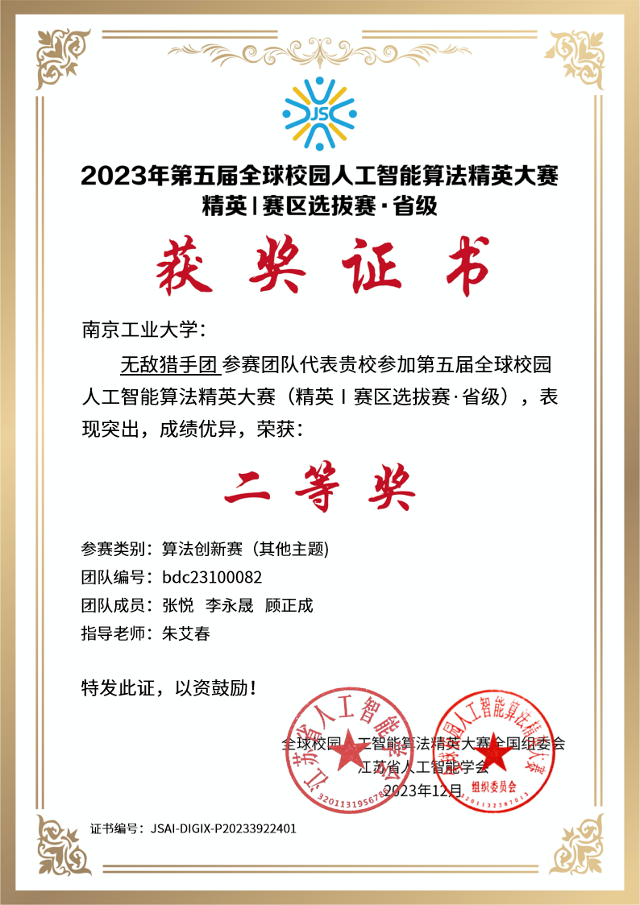

### National Award

**Second Prize — National Final**
The 5th Global Campus Artificial Intelligence Algorithm Elite Competition (2023)

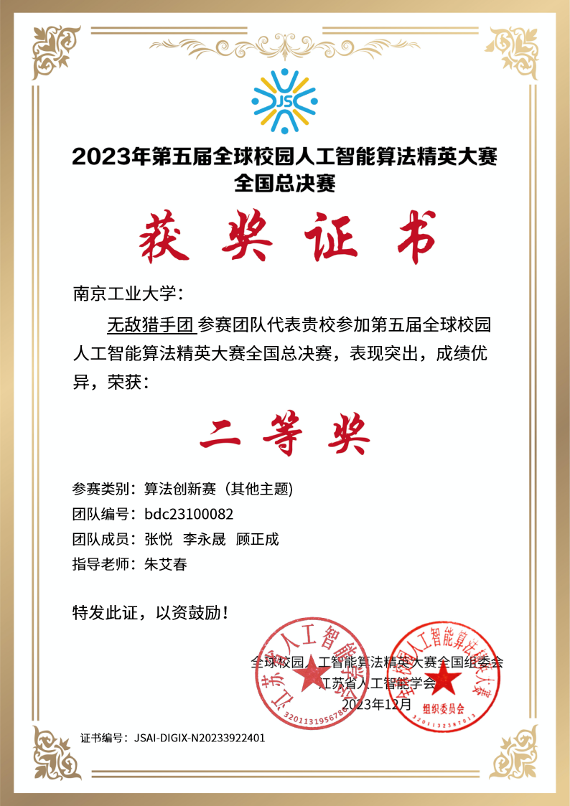

## System Overview

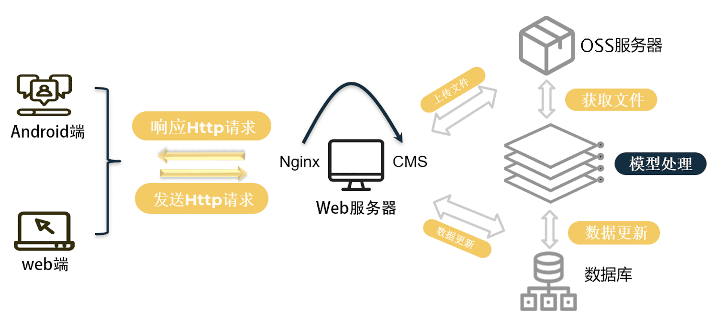

### How ImageHunter Runs

1. A user signs in on Android or the web and receives a time-limited authentication token.
2. For uploads, retrieval, or description generation, Nginx validates the token and routes the authorized request to CMS.
3. CMS coordinates object storage and database updates, and invokes the model service when media analysis is requested.
4. The web service returns the processing result to the client. Description generation and retrieval are separate model capabilities.

## Mobile App

The mobile app is the primary experience for uploading and managing media, generating descriptions, and retrieving content.

### Home & Upload

The home screen provides a direct upload entry and clear access to description generation and search. Users can upload image or video files from the device.

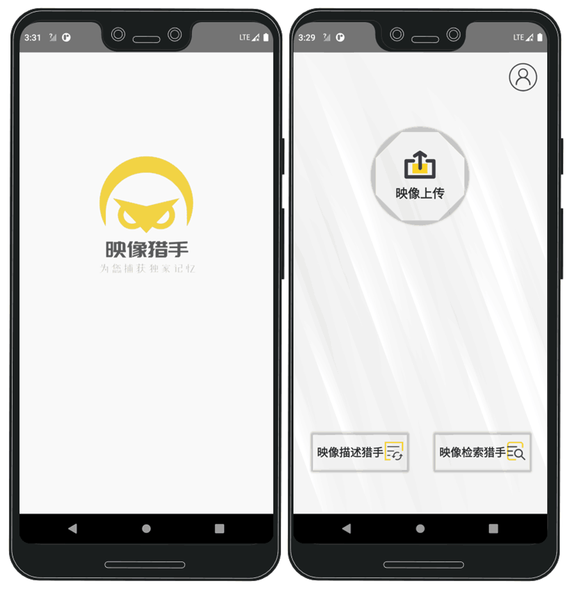

### Natural-Language Retrieval

Describe the content in plain language, select image or video, choose local or cloud computation, and optionally narrow the time range. The retrieval capability independently matches the query to media content and returns results with confidence scores.

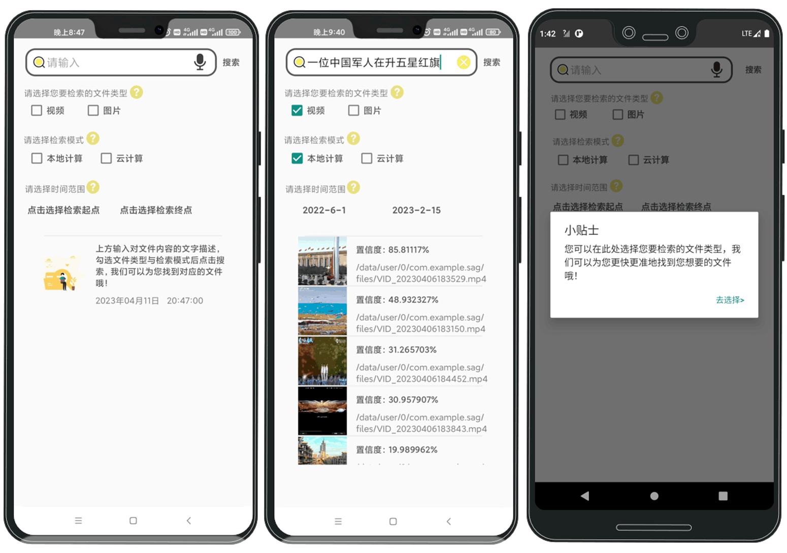

### Media Description Generation

Take or select an image or video, choose its type, and generate a text description with one tap.

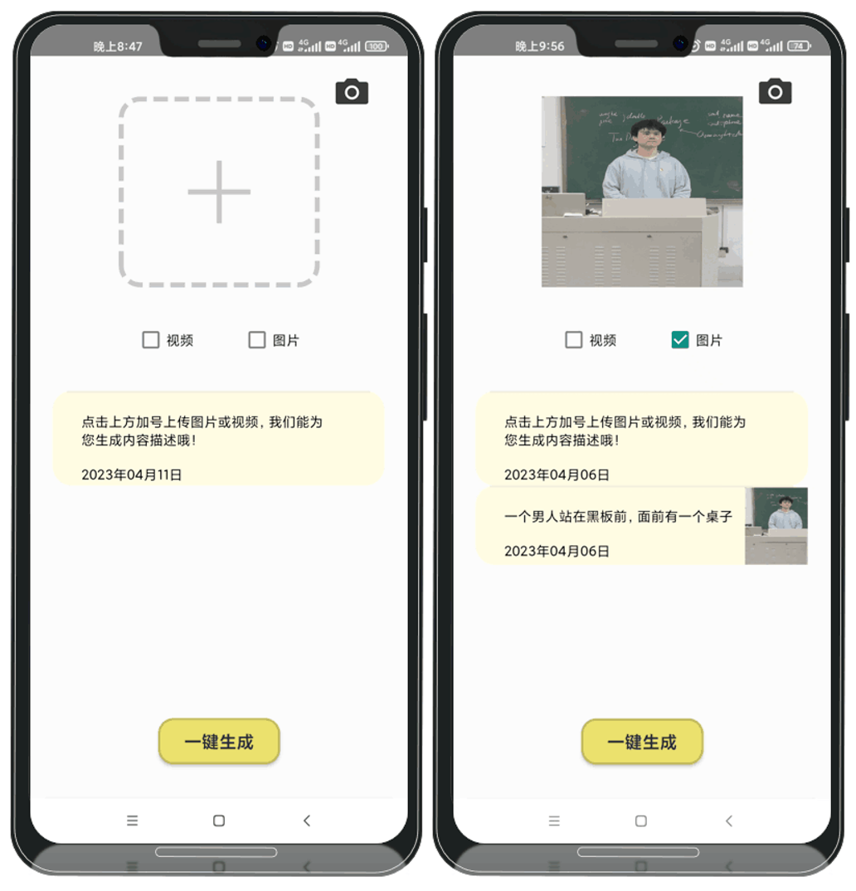

### Personal Space

The personal area brings together daily check-in, cloud storage, privacy information, and account controls.

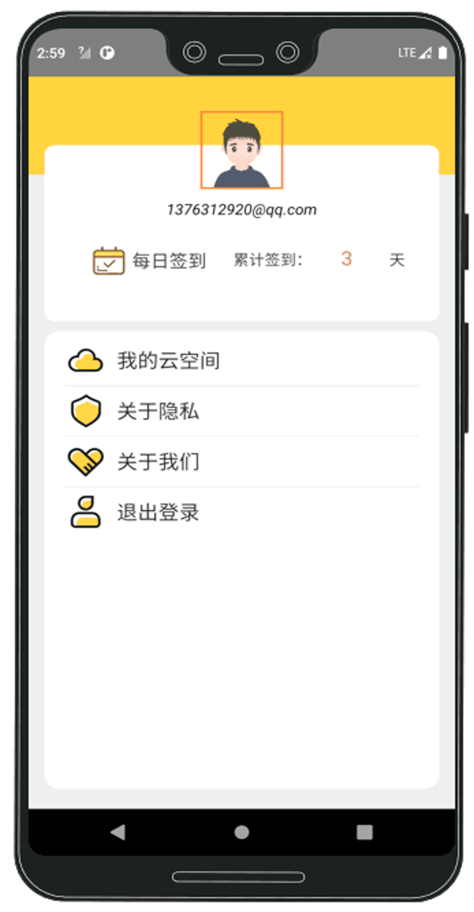

## Web App

The web app offers a streamlined desktop complement to the mobile workflow.

### Home

Landing page and navigation.

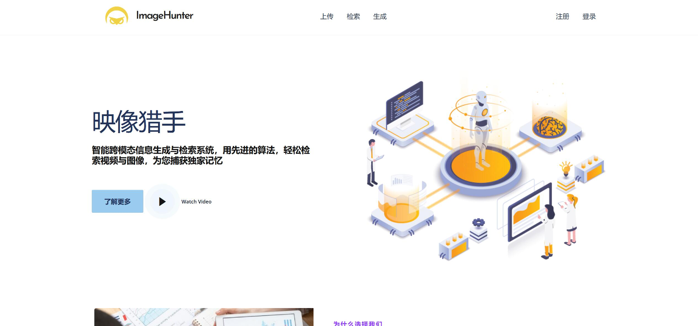

### Search

Text-based media results.

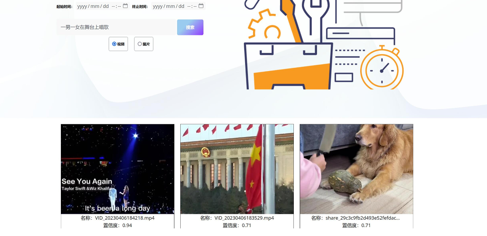

### Generate

Upload media by type.

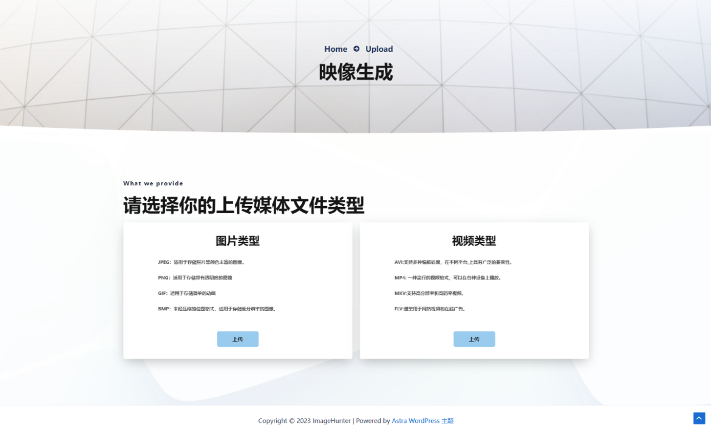

### Personal Space

Browse retrieval history.

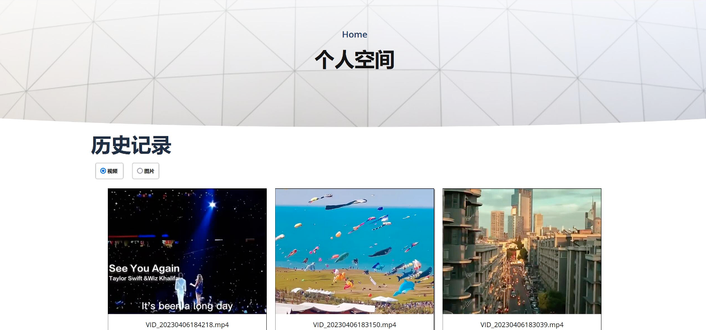

---

[阅读中文版 →](README_ZH.md)
